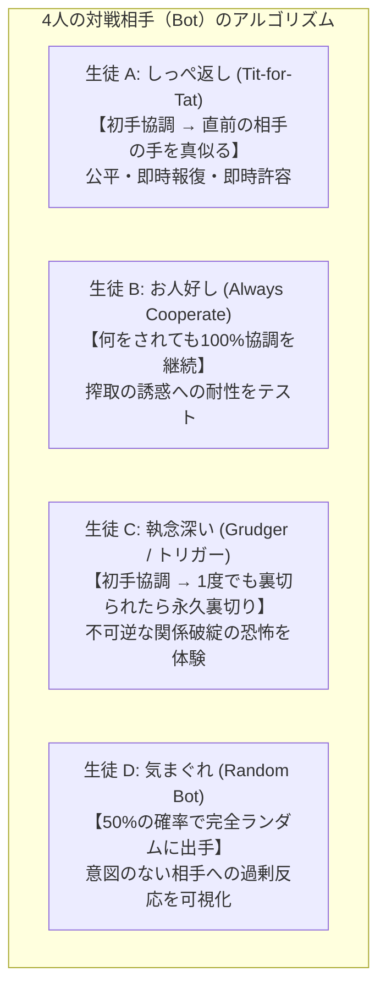

# 【ゲーム理論×自己認知】「信じる？裏切る？ 人間関係シミュレーター 高校生探究版」で暴く、あなたの思考のクセ

> **「自分が価値を置くものに向かって こつこつ努力する姿ほど 素晴らしいものはない」**  
> — テラオカ電子の自由探究ゼミ（Teraoka-Denshi）

---

## はじめに：人間関係の「損得」と「信頼」に悩むすべての高校生へ

高校生活を送る中で、こんな葛藤を感じたことはないでしょうか。

* 「文化祭の準備で、自分ばかり真面目に作業していて、サボっている人が得をしている気がする」
* 「テスト直前、友達に分かりやすいまとめノートを見せてあげたのに、相手は重要なプリントを隠していた」
* 「グループワークで、面倒な調べ学習を誰かがやってくれるのを待って、自分は手を抜いてしまった」
* 「一度裏切られたり意地悪されたりした友達に対して、意地になってずっと口を利かずにいたら、関係が修復できなくなってしまった」

私たちは学校生活の中で、毎日のように「他者を信じて協力するか、それとも自分だけの利益や安全を守るために裏切る（手を抜く・独占する）か」という選択を迫られています。

「みんなで協力したほうが良い結果になる」ということは、頭では誰でも分かっています。それなのに、なぜ私たちは時に人を裏切ってしまったり、逆に裏切られることを恐れて最初から警戒してしまったり、一度のすれ違いから泥沼の冷戦状態に陥ってしまうのでしょうか。

その答えを解き明かす強力な学問が、ノーベル経済学賞にも深く関わる数学の理論**「ゲーム理論（Game Theory）」**、とりわけ**「繰り返し囚人のジレンマ（Iterated Prisoner's Dilemma）」**です。

今回、テラオカ電子の自由探究ゼミでは、この数理モデルを高校生の身近な日常テーマに落とし込み、自分自身の無意識の対人行動パターンを可視化する教育用Webアプリケーション**「信じる？裏切る？ 人間関係シミュレーター 高校生探究版」**を開発・公開しました。

スマートフォンやPCのブラウザから、インストール不要で誰でもすぐにプレイできる完全無料の教材です。

本記事では、このアプリの目的、背後にあるゲーム理論の深い数学的仕組み、アプリの多彩な機能とプログラミング構造、そして「総合的な探究の時間」や「情報I」「公共」といった授業で生徒のメタ認知能力を飛躍的に高める活用方法まで、詳しくお届けします。

---

## 第1章：アプリの目的と教育的ねらい（「自分の思考のクセ」の客観視）

### 1. 感情で行っている日常を「データ」として可視化する
私たちが友人関係で下している判断の多くは、「なんとなく」「その場の感情」「相手の雰囲気」によって決まっています。そのため、自分が人間関係においてどのような行動パターン（思考のクセ）を持っているのかを、自分自身で正確に把握することは極めて困難です。

ある人は「自分は誰にでも優しく接するタイプだ」と思い込んでいながら、相手が絶対に怒らないと分かった途端に甘えて仕事を押し付けているかもしれません。  
またある人は「自分は合理的で冷静だ」と思っていながら、一度でも相手に裏切られるとプライドが傷つき、感情的な意地の張り合いを何週間も続けているかもしれません。

本アプリの最大の目的は、**「ゲーム理論という客観的な鏡（鏡面シミュレーター）を通して、自分の無意識の人間関係のクセを白日の下に晒し、客観的に自己内省（メタ認知）すること」**にあります。

### 2. 本アプリが測定する「3つの主要指標」
アプリの中で、プレイヤーは正体を知らされない4人の生徒（プログラムされたBot）と連続して対戦します。その対戦ログから、アプリは以下の3つの決定的な性格指標を自動的に算出します。

#### ① 初期信頼度（ファーストコンタクトの傾向）
* **測定内容**: 初対面の相手と初めて関わる際、最初の一手で「相手を信じて協力したか」の確率。
* **分析の視点**: 
  高い人は「性善説」に基づき、オープンに心を開いて味方を増やしやすいタイプです。一方、低い人は警戒心が強く、まず防衛線を張って様子を見るタイプです。どちらが良い悪いではなく、「自分が初対面の相手に対してどれほど身構えているか」を客観視します。

#### ② 許容度と報復期間（アンガーマネジメント）
* **測定内容**: 相手に裏切られた直後、自分も連続して何回裏切り（仕返し）を返したかの平均ターン数。
* **分析の視点**:
  仕返しが1回程度で終わり、すぐに協力関係を再構築しようとする人は「寛容で切り替えが早いタイプ」です。反対に、仕返しを3ターン以上も続けたり、最後まで裏切り続けたりする人は「感情を引きずり、自ら共倒れの泥沼にはまるタイプ」です。学校生活における友人とのケンカの長期化傾向がここに現れます。

#### ③ 搾取性・誘惑への耐性（倫理観とフェアプレイ精神）
* **測定内容**: 「相手が絶対に反撃してこないお人好し」だと気づいた後半戦において、あえて裏切りを選んで自分だけ高得点を奪いにいった割合。
* **分析の視点**:
  相手が反撃してこないと分かったとき、「ラッキー、あいつを利用して自分だけ楽をしよう」と搾取に走るか、それとも「相手が協力してくれるのだから、こちらも誠実であり続けよう」と平和な協調を保てるかという、人間の倫理観とリアリズムの境界線を浮き彫りにします。

### 3. スマートフォン完全対応のUI設計
高校生が探究学習や日々の自習でストレスなく利用できるよう、スマートフォンでの片手操作を前提としたUI（ユーザーインターフェース）を構築しています。
複雑な入力は一切不要で、画面に表示される大きな2つのボタン「【協力する】」「【裏切る】」をタップするだけで、直感的にシミュレーションを進めることができます。

---

## 第2章：ゲーム理論「繰り返し囚人のジレンマ」の徹底解説

本アプリの心臓部となっている**ゲーム理論（Game Theory）**について、高校生にもわかるように歴史・数学的構造・現代の応用まで深く掘り下げて解説します。

### 1. 囚人のジレンマの誕生と古典的ストーリー
ゲーム理論は、1940年代に天才数学者ジョン・フォン・ノイマンと経済学者オスカー・モルゲンシュテルンによって創始されました。「複数の意思決定主体（プレイヤー）が、互いの行動に影響を与え合いながら自分の利益を最大化しようとする状況」を数学的に解析する学問です。

その中でも最も有名なモデル「囚人のジレンマ」は、1950年にアメリカの数学者アルバート・タッカー（Albert Tucker）によって考案されました。彼が学生たちに講義を行う際、以下のような寓話を用いて説明したのが始まりです。

> **【囚人のジレンマの寓話】**  
> ある重大な犯罪の容疑で、2人の共犯者 A と B が警察に逮捕されました。  
> 警察は決定的な証拠を欠いていたため、2人を別々の取調室に隔離し、それぞれに次のような司法取引を持ちかけました。
> 
> * 「もし2人とも黙秘（協力）を貫くなら、証拠不十分で2人とも懲役1年の軽い刑で済む」
> * 「もし自分だけが相手の罪を自白（裏切り）し、相手が黙秘した場合、自白した者は即座に釈放（懲役0年）される。ただし黙秘した相手は懲役10年の重罪となる」
> * 「もし2人ともお互いを裏切って自白した場合、2人とも懲役5年の判決を受ける」

このとき、囚人 A の立場になって論理的に損得を計算してみましょう。
* **相手 B が黙秘した場合**: 
  自分も黙秘すれば懲役1年だが、自白すれば懲役0年（釈放）になる。したがって、自白したほうが得である。
* **相手 B が自白した場合**: 
  自分が黙秘していれば懲役10年だが、自白すれば懲役5年で済む。したがって、やはり自白したほうが得である。

驚くべきことに、**相手が黙秘しようと自白しようと、自分にとっては常に「自白（裏切り）」を選んだほうが刑期が短くなる**のです。
囚人 B も全く同じ計算をします。その結果、極めて合理的で頭の良い2人は、必然的にお互いを裏切り合い、2人とも懲役5年という重い刑を受けることになります。
もし2人がお互いを信じて黙秘し合っていれば、わずか懲役1年で済んでいた（2人合わせて懲役2年）はずなのに、合理的な頭脳が最悪の結果を導いてしまうのです。

### 2. 利得マトリクスと数学的成立条件
このジレンマをスコア形式（点数が高いほど嬉しい）で表現したものが、本アプリで採用している**利得（ペイオフ）マトリクス**です。

| あなた ＼ 相手 | 相手：協力 | 相手：裏切り |
| :--- | :---: | :---: |
| **あなた：協力** | **互いに ＋3点**（協調の報酬） | **自分 0点 ／ 相手 ＋5点**（搾取される） |
| **あなた：裏切り** | **自分 ＋5点 ／ 相手 0点**（独り勝ち） | **互いに ＋1点**（共倒れ） |

ゲーム理論において、利得は以下の4つのアルファベットで一般化されます。
* **T（Temptation to defect）**: 自分だけ裏切る「誘惑」の利得 ＝ **5点**
* **R（Reward for mutual cooperation）**: 相互に協力したときの「報酬」 ＝ **3点**
* **P（Punishment for mutual defection）**: 相互に裏切り合ったときの「罰」 ＝ **1点**
* **S（Sucker's payoff）**: 自分だけ協力して裏切られた「お人好しの損」 ＝ **0点**

#### 数学的条件 ①：強支配の順序
囚人のジレンマが成立するための第1の条件は、以下の不等式です。
```
T ＞ R ＞ P ＞ S （本アプリでは 5 ＞ 3 ＞ 1 ＞ 0）
```
この不等式が成り立つとき、相手の手に関わらず自分は「裏切り」を選んだほうが利得が高くなります。このように、相手がどんな手を出そうと自分にとって常に最良となる戦略を**強支配戦略（Strictly Dominant Strategy）**と呼びます。

#### 数学的条件 ②：協調の社会的是正
第2の条件は、以下の不等式です。
```
2 × R ＞ T ＋ S （本アプリでは 2 × 3 ＝ 6 ＞ 5 ＋ 0 ＝ 5）
```
もしこれが成り立たないと、「1ターン交代で裏切りと協力を交互に行い、5点と0点を山分けする（平均2.5点）」ほうが、「2人でずっと協力し続ける（1人3点）」よりも社会全体の合計得点が高くなってしまいます。双方が協力し続けることが社会全体にとって最善であるために、この条件が不可欠です。

### 3. ナッシュ均衡とパレート最適の悲劇
* **ナッシュ均衡（Nash Equilibrium）**: 
  どのプレイヤーも、相手の戦略が変わらない限り、自分だけ戦略を変えても得をしない安定した状態。
  一回限りの囚人のジレンマでは、**「互いに裏切り合う（1点, 1点）」が唯一のナッシュ均衡**です。
* **パレート最適（Pareto Optimality）**: 
  誰の満足度（利得）も減らすことなく、誰かの利得を増やすことができない、社会的に無駄のない状態。
  **「互いに協力し合う（3点, 3点）」がパレート最適**です。

ここに近代経済学や社会哲学を揺るがした巨大なパラドックスがあります。  
アダム・スミスはかつて「個々人が自分の利益を最大化しようと自由に行動すれば、見えざる手に導かれて社会全体が豊かになる」と説きました。しかし囚人のジレンマは、**「全員が利己的に自分の利益を最大化しようとすると、見えざる手に導かれて全員が破滅する」**という残酷な現実を数学的に証明してしまったのです。

### 4. 「繰り返しゲーム」とフォーク定理：なぜ信頼が生まれるのか？
では、現実社会の人間関係は常に裏切りと絶望に満ちているのでしょうか？ もちろんそんなことはありません。私たちは日頃、友達を信じ、協力し合って生きています。

その秘密は**「ゲームが明日も繰り返される」**という点にあります。

一回限りの取引（例えば旅先で二度と会わない相手との売買）では裏切りが合理的ですが、クラスメイトや部活動の仲間の関係は、明日も、来週も、来年も続きます。
将来にわたる関係性をモデル化するために、ゲーム理論では**「割引因子 δ（デルタ：0から1の間の値）」**を導入します。δ は「明日もこの関係が続く確率」や「将来の利益をどれくらい重視するか」を表す係数です。

双方がずっと協調し続けた場合の、将来にわたる合計利得の期待値は、等比数列の和として次のように表されます。
```
V(協調) ＝ R ＋ (δ × R) ＋ (δ² × R) ＋ … ＝ R ÷ (1 － δ)
```

一方、最初のターンで相手を裏切って一時的に最大の T点（5点）を奪い取ったものの、怒った相手から永遠に報復され続け、以降はずっと相互裏切りの P点（1点）になってしまった場合の合計利得は次のようになります。
```
V(裏切り) ＝ T ＋ (δ × P) ＋ (δ² × P) ＋ … ＝ T ＋ { (δ × P) ÷ (1 － δ) }
```

裏切らずに協調関係を維持したほうが得になる条件（V(協調) ≧ V(裏切り)）を計算すると、次の美しい不等式が導かれます。
```
δ ≧ (T － R) ÷ (T － P)
```

ここに本アプリの数値（T＝5, R＝3, P＝1）を代入してみましょう。
```
δ ≧ (5 － 3) ÷ (5 － 1) ＝ 2 ÷ 4 ＝ 0.5 （50％）
```

これは歴史的に**「フォーク定理（Folk Theorem）」**と呼ばれる定理の一形態です。  
数学が弾き出した結論は極めて明快です。  
**「明日もこの相手と関係が続く確率が50％以上あるならば、相手を裏切るよりも、信頼して協力し続けるほうが数学的に確実に得をする」**のです。

### 5. ロバート・アクセルロッドの大会と「勝因の4大原則」
1980年、アメリカの政治学者ロバート・アクセルロッド（Robert Axelrod）は、世界中の一流の数学者、経済学者、計算機科学者に呼びかけ、繰り返し囚人のジレンマを戦わせる前代未聞のコンピュータ・トーナメントを開催しました。

名だたる学者たちが、何百行もの複雑で悪辣なプログラム（相手を巧みに罠にはめ、搾取するAI）を提出しました。しかし、優勝をさらったのは、心理学者アナトール・ラパポートが提出した、わずか数行の極めてシンプルな戦略でした。
それが**「しっぺ返し（Tit-for-Tat）」**です。

しっぺ返し戦略のルールは、たったの2行です。
1. **最初のターンは、必ず「協力」する。**
2. **2ターン目以降は、相手が「前回のターンに出した手」と全く同じ手を出す。**

アクセルロッドはこのトーナメント結果を精緻に分析し、長期的な人間関係や競争社会において成功する戦略には、共通する**「4つの黄金原則」**があることを突き止めました。

#### ① 善良さ（Nice）
自分からは決して先に裏切らないこと。トーナメントの上位を占めたプログラムは、すべてこの「善良さ」を備えていました。先に裏切らないことで、無用な報復合戦を未然に防ぐことができます。

#### ② 報復心（Retaliatory）
相手が裏切ってきたときは、即座に毅然と裏切り返すこと。もし裏切られてもニコニコ協力を続けてしまうと、相手から「あいつはカモだ」と見なされ、徹底的に搾取されてしまいます。「理不尽な行為には断固として代償を払わせる」という姿勢が必要です。

#### ③ 寛容さ（Forgiving）
相手が裏切りをやめて協力に戻ってきたら、過去の悪事を根に持たず、即座に協力を再開すること。いつまでも怒りを引きずって仕返しを続けると、お互いに点数を削り合う泥沼（Lose-Lose）から抜け出せなくなります。

#### ④ 明快さ（Clear）
自分の行動方針が相手にとって予測しやすいこと。「何を考えているか分からない複雑な相手」に対して、人間は恐怖を感じて防衛的（裏切り）になります。「信じてくれれば協力するが、裏切られたらやり返す」という透明なルールを持つことが、相手の協調を引き出します。

### 6. 現代社会への応用：地球温暖化からSNSまで
囚人のジレンマは、単なるゲームの枠を超えて、現代社会の最も困難な課題を分析するフレームワークとして使われています。

* **地球温暖化・温室効果ガス削減**:
  すべての国が協力してCO2を排出すれば地球環境は守られます（協調）。しかし、自国だけが環境対策をサボって工場をフル稼働させれば、自国の経済だけが潤います（裏切り）。全員がそう考えると地球が滅びます。
* **企業の価格競争**:
  ライバル企業同士が適正価格を維持すれば共存共栄できますが、自社だけ値下げしてシェアを奪おうとすると、相手も値下げに対抗し、最終的に両社とも利益が出なくなります。
* **SNSでの炎上・攻撃性**:
  SNSは匿名であり、相手と二度と会わない可能性が高い（割引因子 δ が極めてゼロに近い）環境です。そのため「しっぺ返し」や「協調」が機能しにくく、一回限りのゲームのように攻撃や裏切りが横行しやすい構造になっています。

---

## 第3章：アプリの全機能とリアルな高校生シナリオ

本アプリは、この重厚なゲーム理論の世界を、高校生が「自分のこと」として体感できるよう、洗練されたインターフェースと機能で構築されています。

### 1. 高校生活に密着した「5つの対戦シナリオ」
抽象的な「囚人」の設定ではなく、高校生が教室で直面する5つのシチュエーションを選択してスタートできます。

1. **文化祭の備品シェア（学校行事）**:
   * 【協力】: 「お互い様だから！」と大工道具やプロジェクターを丁寧に扱い、時間通りに他クラスと融通し合う。
   * 【裏切り】: 「自分たちの劇の準備が遅れる！」と人気機材を自教室に隠し持って独占する。
2. **探究・グループワークの課題分担（探究学習）**:
   * 【協力】: 休日返上で担当パートのリサーチを進め、分かりやすい発表スライドを共有する。
   * 【裏切り】: 「忙しかった」と言い訳してサボり、他人の完成スライドに名前だけ連名する（フリーライダー）。
3. **定期考査前のノート・情報共有（勉強・考査）**:
   * 【協力】: 自分が苦労してまとめた図入りの神ノートを惜しみなく見せ合い、互いに理解を深める。
   * 【裏切り】: 相手の要点だけスマホで撮らせてもらい、自分のオリジナルまとめは隠して教えない。
4. **部活動のグラウンド整備＆片付け（部活動）**:
   * 【協力】: 疲れていても声を掛け合い、全員でテキパキと道具の片付け・掃除を終わらせる。
   * 【裏切り】: 「足がつった」と日陰で座り込み、他の部員にきつい片付けを押し付ける。
5. **クラスLINE・連絡網の集約（日常・SNS）**:
   * 【協力】: 委員の苦労を思いやり、面倒なアンケートにも1分で回答して全体の進行を助ける。
   * 【裏切り】: 「誰かが答えるだろう」と既読無視を続け、委員に個別に催促させる。

### 2. 直感的でドラマチックな対戦画面
対戦中、プレイヤーは「現在の相手が4人のうち何人目か」「現在のターン数」をプログレスバーで把握しながらプレイします。

* **手元の選択**: 画面中央の大きな2つのボタンをタップ。
* **即時フィードバック演出**:
  選んだ瞬間に、双方の手が開示され、獲得スコアと結果バッジ（「平和的協調 🤝 ＋3pt」「搾取成功 😈 ＋5pt」「搾取された 😢 ＋0pt」「共倒れ 💥 ＋1pt」）がアニメーションで表示されます。
* **行動履歴チップ（タイムライン）**:
  画面下部には、その相手との過去の手の履歴が「自🤝:相🤝 (+3)」「自😈:相🤝 (+5)」といったチップで直近順に並びます。相手の過去の出方を観察しながら、「次の一手」を深く推理することができます。
* **柔軟なターン数設定**:
  授業時間や好みに応じて、1人あたりのターン数を「5ターン（快速・計20戦）」「10ターン（標準・計40戦）」「15ターン（じっくり・計60戦）」からワンタップで切り替え可能です。

### 3. 種明かし画面：対戦相手4人の「正体開示」
4人全員との対戦が終わると、紙吹雪のエフェクトとともに、これまで「生徒 A〜D」として伏せられていた相手プログラムの正体が開示されます。
Chart.jsによる**「相手別スコア比較バーグラフ」**が描画され、「どの相手に対して自分がどれだけ得点を稼いだか（あるいは削り合って共倒れしたか）」が一目瞭然になります。

### 4. 自己分析ダッシュボードと性格診断
本アプリの真骨頂がこのダッシュボードです。

* **3大分析指標のメーター表示**:
  「初期信頼度」「報復の長さ」「搾取性・誘惑耐性」がパーセンテージとターン数で算出され、それぞれに詳細な性格評価コメントが付与されます。
* **5次元パーソナリティ・レーダーチャート**:
  1. 初期信頼感
  2. 寛容さ（復元力）
  3. 誠実・フェア
  4. 防衛・実利力
  5. 協調安定性  
  の5つの軸で、あなたの対人戦略バランスを蜘蛛の巣グラフとして美しくプロファイリングします。
* **人間関係戦略タイプ診断（全6タイプ）**:
  行動ログの複合条件から、以下の6つの称号と詳細なアドバイスを提示します。
  * **スマート・ストラテジスト（しっぺ返し型戦略家）**: 理想的なバランス型。
  * **絶対的ピースメーカー（高潔な調停者）**: 聖人君子型。カモにされる危険に注意。
  * **冷徹なオポチュニスト（利益最大化テイカー）**: 隙を突くリアリスト。悪評リスクに注意。
  * **堅牢なディフェンダー（防衛型ハリネズミ）**: 警戒心の強い慎重派。チャンス損失に注意。
  * **意地のリアクター（感情連鎖型リベンジャー）**: 怒りを引きずるタイプ。泥沼回避を。
  * **柔軟なシチュエーショナリスト（状況適応型）**: 臨機応変だが軸の明快さに課題。
* **全対戦ログテーブル（アコーディオン開閉）**:
  全40ターンの詳細な手、結果、得点推移を完全な表形式で閲覧・検証できます。

### 5. 探究学習用テキスト（.txt）ワンクリック出力機能
画面右上の「💾 探究学習用テキスト（.txt）保存」ボタンを押すだけで、実施日時、選択シナリオ、総合診断、3大指標数値、対戦相手別の詳細成績、全40ターンの完全ログ、そして**探究ノート・振り返りシート用の記述設問欄**が一体となったテキストファイルが瞬時にローカル保存されます。
これを印刷したり、Google Classroom やロイロノートに提出することで、そのまま探究学習の成果物として活用できます。

---

## 第4章：正体不明の4人の対戦Bot（アルゴリズム詳細）

シミュレーションの裏側で動いている4人のBotは、人間社会に実在する代表的な行動原理をモデル化したものです。



### 1. 生徒 A: しっぺ返し（Tit-for-Tat）
* **ロジック**: 1ターン目は必ず協力。以降はプレイヤーが直前のターンに出した手をそのまま返す。
* **心理的体験**:
  プレイヤーが協力を続ければずっと3点（Win-Win）が続きます。もしプレイヤーが裏切ると、次のターンで即座に裏切り返されます。しかし、プレイヤーが反省して協力に戻すと、生徒Aも次のターンですぐに協力に戻ってくれます。「最も信頼できる、フェアな友人」の姿です。

### 2. 生徒 B: お人好し（Always Cooperate）
* **ロジック**: プレイヤーが何をしようと、最後まで100％協力を出し続ける。
* **心理的体験**:
  プレイヤーが裏切ると、毎回5点が手に入ります。生徒Bは絶対に怒りません。ここでプレイヤーの心に**「悪魔のささやき」**が生じます。「こいつはずっと協力してくるから、自分はずっと裏切り続ければ毎回5点取れて大勝できるぞ」。
  この誘惑に負けて搾取を続けるか、それとも良心の呵責を感じて協力に戻すか。プレイヤーの真の倫理観が試されます。

### 3. 生徒 C: 執念深い（Grudger / トリガー戦略）
* **ロジック**: 最初はずっと協力するが、プレイヤーが一度でも裏切りを出した瞬間、それ以降の全ターンで永久に裏切りを出し続ける。
* **心理的体験**:
  最初は生徒Bと同じように見えます。しかし、出来心で一度裏切ったが最後、生徒Cの目は永遠に冷酷になります。プレイヤーがどれだけ「協力」を出して謝罪のサインを送っても、生徒Cは二度と信じてくれず、プレイヤーは0点、生徒Cは5点という最悪の搾取が続きます。
  「現実の人間関係において、一度の裏切りがどれほど取り返しのつかない破滅をもたらすか」という恐怖を強烈に教え込むBotです。

### 4. 生徒 D: 気まぐれ（Random Bot）
* **ロジック**: コインを投げるように、50％の確率で完全ランダムに手を決める。
* **心理的体験**:
  生徒Dには悪気も計算もありません。しかし、人間はランダムな相手に対しても「あいつは今、わざと俺を試したな」「嫌がらせをしてきたな」と勝手に意図を深読みし、怒って裏切り返してしまいます。人間がいかに「相手の行動に勝手なストーリーを貼り付けて自爆しやすいか」を浮き彫りにします。

---

## 第5章：プログラムの構造・技術スタックとVercelデプロイ

本アプリは、教育現場での導入のしやすさと堅牢性を最優先に考慮し、極めて洗練されたアーキテクチャで開発されています。

### 1. 「完全単一ファイル（Single File SPA）」という思想
学校現場のICT環境には、さまざまな制約があります。
* 「セキュリティ制限で外部サーバーとのAPI通信がブロックされる」
* 「生徒の個人情報や入力ログが外部サーバーに送信されるとプライバシー上の問題がある」
* 「Node.jsやnpmなどのビルド環境を学校の端末にインストールできない」

これらの課題を根本から解決するため、本アプリは**`index.html` というたった1つのファイルの中に、HTML構造、CSSスタイリング、JavaScriptロジック、数式描画、グラフ描画、効果音シンセサイザーのすべてを完全内包**しています。
外部サーバーとの通信は一切行わず、すべての計算とデータ保持がブラウザのメモリ内だけで完結するため、情報漏洩のリスクは原理的にゼロです。

### 2. 採用された技術スタック
* **Tailwind CSS (CDN)**:
  ダークモード（`slate-950` 基調）をベースに、シアン、エメラルド、ローズ、アンバーなどの高コントラストな配色を適用。長時間の学習でも目の疲れない美しいUIを実現。
* **Vanilla JavaScript (ES6+)**:
  ReactやVueなどの重量フレームワークを使わず、ピュアなJavaScriptで状態管理（State Machine）を構築。極めて高速に動作し、スマートフォンの省電力モードでも滑らかにアニメーションします。
* **Chart.js**:
  スコア比較棒グラフおよび5次元レーダーチャートの動的レンダリングを担当。
* **Web Audio API（内蔵シンセサイザー）**:
  一般的なWebゲームのようにMP3やWAVといった外部音声ファイルを読み込むのではなく、ブラウザの音声合成機能（オシレーター）を使って、周波数を指定した心地よい電子音（協調音、裏切り音、ファンファーレ）をリアルタイム生成しています。これにより、音声ファイルの読み込み失敗や通信遅延が一切発生しません。
* **KaTeX (LaTeXエンジン)**:
  モーダル内の高度な数式（等比級数の和、フォーク定理）を美しく描画。
* **canvas-confetti**:
  全対戦クリア時の達成感を高める紙吹雪エフェクト。

### 3. Vercelへのデプロイと世界配信
本アプリは静的ファイルのみで構成されているため、クラウドプラットフォーム**Vercel**との相性が抜群です。

リポジトリ直下に以下の最小構成の `vercel.json` を配置しています。
```json
{
  "version": 2,
  "cleanUrls": true,
  "framework": null
}
```

GitHubリポジトリ（`Teraoka-Hiroki/ThePrisonersDilemma`）とVercelを連携させるだけで、GitHubにプッシュされるたびに自動でCI/CDパイプラインが走り、わずか数秒で世界最高速のCDNエッジネットワークへデプロイされます。生徒全員が40人一斉にアクセスしても、サーバーダウンの心配は全くありません。

---

## 第6章：授業での実践指導案と生徒の「メタ認知能力」向上

本シミュレーターを高校の授業で効果的に活用するための具体的な指導モデル案を提案します。

### 1. 授業の位置づけと該当単元
* **「総合的な探究の時間」**: 自己理解・人間関係の構築・コミュニケーションの探究
* **「公共・倫理」**: 個人の自由と公共の福祉、社会的ジレンマ、合理的配慮と正義
* **「情報I」**: モデル化とシミュレーション、意思決定支援アルゴリズム

### 2. 50分間のモデル授業展開案

| 時間 | フェーズ | 教師の働きかけ・生徒の活動 |
| :--- | :--- | :--- |
| **0〜10分** | **導入（問題提起）** | 文化祭や部活動のサボり問題を例に挙げ、「協力すべきと分かっているのに、なぜサボる人が出るのか？」を問いかける。利得表のルール（Win-Win、搾取、共倒れ）を簡単に説明する。 |
| **10〜25分** | **個人シミュレーション** | 各自のスマホやタブレットでアプリにアクセス。好きなシナリオを選び、4人の相手と対戦（10ターン×4人＝40戦）を行う。※この時点では相手の正体は明かさない。 |
| **25〜35分** | **種明かし＆データ分析** | 4人のBotの正体が開示される。自分のレーダーチャートと3大指標を確認し、テキストファイル（.txt）をダウンロードして保存する。 |
| **35〜45分** | **グループ対話（内省）** | 3〜4人のグループを作り、レポートを見せ合いながら「問い」について議論する（後述）。 |
| **45〜50分** | **まとめと理論解説** | アクセルロッドの勝因4原則（善良・報復・寛容・明快）を解説し、これからの学校生活への活かし方をまとめる。 |

### 3. 生徒の「メタ認知（客観的自己理解）」が劇的に高まる瞬間
このアプリを体験した生徒は、ほぼ例外なく**「自分自身の行動に対する衝撃的な気づき」**を得ます。

#### 気づき ①：「自分はお人好しを利用する側の人間だった」
普段はおとなしく優しい生徒が、生徒B（お人好し）に対して後半戦で連続して「裏切り」を選んでいたことに気づきます。  
「自分は絶対に人をいじめたり利用したりしないと思っていたけれど、『相手が絶対に反撃してこない』と分かった途端、自分だけ5点を取りにいってしまった。自分の中にこんなずるい計算があったのか……」という強烈な自己内省が生まれます。

#### 気づき ②：「意地の張り合いが、自分の点数を一番削っていた」
生徒C（執念深い）に裏切られた後、カッとなって最後まで裏切りを出し続けた生徒は、最終スコアが極めて低くなります。  
「あいつがムカつくから仕返しを続けてやったけれど、結果として自分も毎ターン1点しか取れず、トータルスコアで最下位になってしまった。『許さないこと』は相手への罰のつもりだったけれど、実は自分自身を一番傷つけていたんだ」という事実に、数理データを通じて直面します。

### 4. 探究ノートを深める「4つの発問」
グループワークやレポート作成時には、以下の問いを投げかけることで対話が深まります。

1. **「生徒B（お人好し）だと気づいたとき、あなたは何を考え、なぜその手を選びましたか？」**
2. **「生徒C（執念深い）に一度裏切ってしまった後、どんな感情が湧きましたか？ 仲直りは可能でしたか？」**
3. **「現実のあなたの学校生活（部活、テスト勉強、友達付き合い）での行動パターンと、今回のシミュレーターの結果はどれくらい一致していましたか？」**
4. **「アクセルロッドの勝因4原則（善良・報復・寛容・明快）の中で、これからの自分の生活に一番取り入れたい原則は何ですか？」**

---

## 第7章：人間関係のジレンマを乗り越える「ゲーム理論的処方箋」

最後に、このシミュレーターとゲーム理論が教えてくれる、高校生がこれからの人生をより豊かに生きるための**実践的な処方箋**をまとめます。

### 1. 「お人好し」でいるのをやめ、「しっぺ返し」の強さを持つ
誰にでも優しく、何をされても怒らない生徒Bのような生き方は、一見すると美しく見えます。しかしゲーム理論が証明している通り、そのような無防備な態度はいずれ必ず「搾取者（テイカー）」を引き寄せ、自分をボロボロにしてしまいます。
大切なのは、アクセルロッドの原則通り、**「普段は親切にするけれど、理不尽に裏切られたときは毅然と怒る（NOと言う）」**という健全な境界線を持つことです。

### 2. 「許す」ことは、相手のためではなく「自分のため」である
誰かに傷つけられたとき、その怒りを何ヶ月も引きずり、無視や陰口を続けることは、ゲーム理論的に言えば**「自ら率先して相互裏切り（Lose-Lose: 1点）の泥沼に居座り続ける」**行為です。
相手が謝ってきたら、あるいは改心の兆しを見せたら、サッと水に流して協調関係（Win-Win: 3点）を再開する。寛容さとは、道徳的な自己犠牲ではなく、**「自分の将来の利得を最大化するための最も賢明な合理性」**なのです。

### 3. 「明日も会う」関係性（割引因子 δ）を大切にする
一回きりの関わり（ネットの掲示板や、電車で隣り合わせた見知らぬ人）では、人は簡単に冷酷になれます。
しかし、同じ教室で学ぶ仲間、部活動のチームメイト、家族とは、明日も明後日も顔を合わせます。この**「明日も関係が続くという確信（高い割引因子 δ）」**こそが、人間が信頼を紡ぐための最大の土台です。目の前の小さな損得よりも、長期的な信頼関係という大きな果実に目を向けることの重要性がここにあります。

---

## おわりに

人間関係に悩んだとき、私たちはつい「あの人の性格が悪いからだ」「自分にコミュニケーション能力がないからだ」と、個人の感情や人格のせいにしてしまいがちです。

しかし、ゲーム理論のレンズを通して人間関係を眺めてみると、そこには**「環境のルール」と「情報構造」が生み出す、冷徹な数理的メカニズム**が横たわっていることが分かります。
仕組みが分かれば、感情に振り回されることなく、冷静に「では、どうすれば互いに協調できるルールを作れるだろうか？」という前向きな探究へと舵を切ることができます。

「信じる？裏切る？ 人間関係シミュレーター 高校生探究版」が、多くの高校生の自己理解を深め、教室に豊かな対話と信頼をもたらすきっかけとなることを心から願っています。

ぜひ、ブラウザから体験し、あなた自身の「思考のクセ」を覗いてみてください。

---

### アプリのアクセス情報・ソースコード
* **GitHub リポジトリ**:  
  [https://github.com/Teraoka-Hiroki/ThePrisonersDilemma.git](https://github.com/Teraoka-Hiroki/ThePrisonersDilemma.git)
* **開発・提供**:  
  テラオカ電子の自由探究ゼミ（Teraoka-Denshi）  
* **著作権表示**:  
  © 2026 Teraoka-Denshi. All rights reserved.
